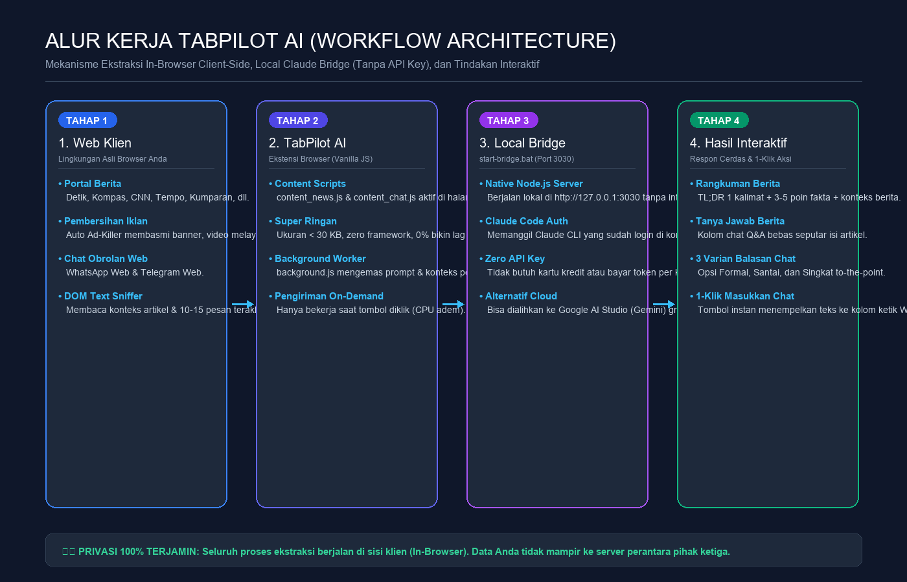

<div align="center">

  

  # TabPilot AI ⚡
  **Ultra-Lightweight In-Browser AI Companion for Distraction-Free News & Contextual Chat**
  <br>
  <sub>Crafted with passion by <strong><a href="https://musolutionlab.com">musolutionlab</a></strong></sub>

  <br><br>

  [](https://musolutionlab.com)
  [](LICENSE)
  []()
  []()
  []()
  []()

  <p align="center">
    <strong>TabPilot AI</strong> adalah ekstensi browser open-source karya <strong>musolutionlab</strong> yang dirancang untuk membersihkan iklan portal berita, merangkum dan tanya-jawab artikel secara instan, serta membantu Anda menyusun balasan pesan cerdas di WhatsApp Web & Telegram Web — <em>bisa berjalan 100% tanpa API key berbayar!</em>
  </p>

</div>

---

## 📑 Daftar Isi
- [Kenapa TabPilot AI?](#-kenapa-tabpilot-ai)
- [Fitur Utama](#-fitur-utama)
  - [1. Pembersih Berita, Reader Mode & Tanya Jawab AI](#1-pembersih-berita-reader-mode--tanya-jawab-ai)
  - [2. WhatsApp & Telegram Chat Copilot](#2-whatsapp--telegram-chat-copilot)
- [Arsitektur Tanpa API Key (Local Claude Bridge)](#-arsitektur-tanpa-api-key-local-claude-bridge)
- [Panduan Instalasi & Penggunaan](#-panduan-instalasi--penggunaan)
- [Struktur Proyek](#-struktur-proyek)
- [Privasi & Keamanan](#-privasi--keamanan)
- [Lisensi](#-lisensi)

---

## 💡 Kenapa TabPilot AI?

Banyak ekstensi AI di Web Store yang:
- ❌ **Sangat berat:** Menyuntikkan bundle React/Vue ratusan megabyte ke setiap tab yang membuat browser lemot.
- ❌ **Wajib langganan berbayar / API Key mahal:** Memaksa memasukkan kartu kredit atau token berbayar.
- ❌ **Pelanggaran Privasi:** Mengirim data Anda ke server perantara pihak ketiga.

**TabPilot AI** memecahkan masalah ini dengan pendekatan:
1. **🪶 Super Enteng (< 30 KB):** Dibuat 100% menggunakan Vanilla JavaScript standar tanpa framework pihak ketiga. Nol beban CPU saat browsing santai.
2. **🔓 Bebas Biaya (Zero API Key):** Terhubung langsung ke sesi login **Claude Code** yang sudah ada di komputer Anda via jembatan lokal.
3. **🔒 100% Private (Client-Side):** Permintaan dikirim langsung dari perangkat Anda sendiri ke engine AI tanpa ada server perantara.

---

## ✨ Fitur Utama

### 1. 📰 Pembersih Berita, Reader Mode & Tanya Jawab AI
Didesain khusus untuk portal berita Indonesia (Detik, Kompas, CNN Indonesia, Kumparan, Tempo, Tribun, CNBC, Medium, dll):
* **Pembersih Iklan Otomatis:** Membasmi banner promosi agresif, video melayang (*floating sticky video*), pop-up, dan widget clickbait secara otomatis.
* **📖 Mode Bersih (Distraction-Free Reader):** Menyulap artikel panjang menjadi tampilan buku/Medium dengan tipografi elegan yang nyaman dibaca.
* **⚡ Rangkuman Berita 30 Detik:**
  * 📌 **TL;DR:** Ringkasan 1 kalimat padat.
  * 🔑 **Poin Penting:** 3-5 butir fakta inti dari berita.
  * 💡 **Konteks & Dampak:** Apa arti peristiwa tersebut bagi pembaca.
* **💬 Tanya Jawab (Q&A) Interaktif:** Anda bisa mengetik pertanyaan bebas seputar artikel (misal: *"Siapa saja yang diperiksa?"*, *"Berapa total kerugiannya?"*) atau klik chip pertanyaan instan.

### 2. 💬 WhatsApp & Telegram Chat Copilot
Asisten pribadi yang aktif di ruang obrolan [web.whatsapp.com](https://web.whatsapp.com) dan [web.telegram.org](https://web.telegram.org):
* **⚡ Rangkum Obrolan:** Membaca konteks 10–15 pesan terakhir untuk merangkum topik utama dan status pembicaraan (siapa menunggu respon apa).
* **✍️ 3 Varian Balasan Otomatis:**
  1. 👔 **Formal & Sopan:** Nada profesional dan santun (cocok untuk klien, atasan, atau urusan bisnis).
  2. ☕ **Santai & Friendly:** Nada kasual dan ramah (cocok untuk teman, rekan akrab, atau grup santai).
  3. ⚡ **Singkat & To-the-Point:** Jawaban langsung ke inti tanpa bertele-tele.
* **💡 Instruksi Khusus & Tanya Chat:** Ketik instruksi bebas seperti *"Tolak halus karena jadwal padat"* atau *"Tanyakan maksudnya"* ➔ AI merancang draf balasan sesuai arahan Anda.
* **📨 1-Klik Masukkan ke Chat:** Cukup klik tombol `📨 Masukkan ke Chat`, teks balasan otomatis tertempel di kolom ketik WhatsApp/Telegram. Tinggal tekan Enter!

---

## 🔌 Arsitektur & Alur Kerja (Workflow Diagram)

TabPilot AI menghubungkan browser Anda langsung ke model AI tanpa perantara server pihak ketiga:

<div align="center">
  
</div>

<br>

Jika komputer Anda sudah terpasang dan login di [Claude Code](https://docs.anthropic.com/en/docs/agents-and-tools/claude-code/overview), Anda tidak perlu mendaftar API key berbayar. Cukup jalankan `start-bridge.bat`!

> **Pilihan Lain:** Jika Anda ingin menggunakan **Google AI Studio / Gemini**, Anda juga bisa memasukkan API Key gratis (tanpa kartu kredit) dari [aistudio.google.com](https://aistudio.google.com/).

---

## 🚀 Panduan Instalasi & Penggunaan

### 1. Clone atau Unduh Repositori
```bash
git clone https://github.com/MUSHANIF/TabPilot-AI.git
cd TabPilot-AI
```

### 2. Jalankan Local Bridge (Untuk Claude Login Tanpa API Key)
Klik ganda file:
```bash
start-bridge.bat
```
*(Atau jalankan `node server.js` di terminal. Jendela ini cukup diminimize selama browsing).*

### 3. Pasang Ekstensi di Browser (Chrome, Edge, Brave)
1. Buka browser Anda dan tuju halaman ekstensi:
   * **Chrome:** `chrome://extensions`
   * **Edge:** `edge://extensions`
   * **Brave:** `brave://extensions`
2. Aktifkan sakelar **Developer mode** (Mode Pengembang) di pojok kanan atas.
3. Klik tombol **Load unpacked** (Muat yang belum dibongkar) di kiri atas.
4. Pilih folder repositori `tabpilot-ai`.
5. Buka popup ekstensi di toolbar browser untuk memastikan status bridge berwarna:  
   `🟢 Aktif & Siap Digunakan (Port 3030)`.

---

## 📁 Struktur Proyek

```text
tabpilot-ai/
├── manifest.json         # Konfigurasi Chrome Extension Manifest V3
├── popup.html            # Antarmuka Pengaturan & Pemilihan Provider AI
├── popup.js              # Logika konfigurasi, penyimpanan, dan tes koneksi
├── background.js         # Service Worker background & gateway AI
├── content_news.js       # Pembersih iklan, reader mode, rangkuman & Q&A berita
├── news_reader.css       # Styling mode baca & modal Q&A berita
├── content_chat.js       # Copilot obrolan WhatsApp & Telegram Web
├── chat_copilot.css      # Styling floating drawer copilot chat
├── server.js             # Local AI Bridge server (Node.js native)
├── start-bridge.bat      # 1-klik starter script untuk Windows
├── icon.svg              # Logo vektor TabPilot AI
├── icon16.png            # Favicon 16x16
├── icon48.png            # Icon toolbar 48x48
├── icon128.png           # Icon Web Store 128x128
├── .gitignore            # Git ignore rule
├── LICENSE               # Lisensi MIT
└── README.md             # Dokumentasi lengkap proyek
```

---

## 🔒 Privasi & Keamanan

* **Zero Telemetry:** TabPilot AI tidak melacak halaman apa yang Anda kunjungi atau obrolan chat Anda.
* **On-Demand Processing:** Data obrolan atau teks berita hanya diekstrak saat Anda menekan tombol perintah AI.
* **Lokal & Transparan:** Seluruh kode sumber terbuka (*open source*) dan dapat Anda periksa langsung setiap baris kodenya.

---

## 📄 Lisensi

Didistribusikan di bawah lisensi **MIT License**. Silakan baca berkas [LICENSE](LICENSE) untuk informasi lebih lanjut.

---

<div align="center">
  <br>
  <sub>Copyright &copy; 2026 <strong><a href="https://musolutionlab.com">musolutionlab</a></strong>. All rights reserved.</sub><br>
  <sub>Dibuat dengan ❤️ untuk pengalaman browsing yang lebih cerdas, bersih, dan produktif.</sub>
</div>
